 

<a href="https://devhammad.vercel.app"><strong>PORTFOLIO ↗</strong></a>
&nbsp;&nbsp; / &nbsp;&nbsp;
<a href="https://github.com/hammad-44"><strong>GITHUB ↗</strong></a>

  

 

<table>
<tr>
<td width="58%" valign="top">

### A LITTLE ABOUT ME

I’m Hammad — a developer interested in the space between **useful engineering and ambitious ideas**.

I work across the stack, from Python backends and React interfaces to machine-learning experiments and computer-vision systems.

I like projects with a clear purpose, thoughtful details, and enough complexity to teach me something.

</td>
<td width="42%" valign="top">

### CURRENT TOOLBOX

`Python` `Django` `FastAPI`

`React` `JavaScript` `Firebase`

`Machine Learning` `OpenCV` `OCR`

`Java` `Android` `Git`

</td>
</tr>
</table>

---

01 &nbsp; / &nbsp; SELECTED EXPERIMENTS

<table>
<tr>
<td width="50%" valign="top">

### ScamAway

**Security / Machine learning**

A phishing-URL detection project pairing a React interface with a Python API and a trained classifier.

`REACT` &nbsp; `FASTAPI` &nbsp; `ML`

[VIEW REPOSITORY ↗](https://github.com/hammad-44/ScamAway-web)

</td>
<td width="50%" valign="top">

### VisageGuard

**Computer vision / Desktop**

A desktop face-search concept built around local records, image matching, and structured record management.

`PYTHON` &nbsp; `OPENCV` &nbsp; `CUSTOMTKINTER`

</td>
</tr>
<tr>
<td width="50%" valign="top">

### Web Armor

**Web security / Django**

A website analysis tool that presents web-related findings through a straightforward Django interface.

`PYTHON` &nbsp; `DJANGO` &nbsp; `WEB SECURITY`

</td>
<td width="50%" valign="top">

### Number Plate Recognition

**Computer vision / OCR**

An offline project exploring detection and text recognition for Pakistani vehicle number plates.

`YOLO` &nbsp; `OPENCV` &nbsp; `OCR`

</td>
</tr>
</table>

---

02 &nbsp; / &nbsp; HOW I LIKE TO WORK

<table>
<tr>
<td width="33%" valign="top">

**01 — Understand**

Start with the real problem, not the trendiest technology.

</td>
<td width="33%" valign="top">

**02 — Build**

Make the core workflow work before adding unnecessary complexity.

</td>
<td width="33%" valign="top">

**03 — Refine**

Improve clarity, reliability, and the details people actually notice.

</td>
</tr>
</table>

---

### MORE FROM THE WORKBENCH

<a href="https://github.com/hammad-44?tab=repositories">Browse all repositories ↗</a>
&nbsp;&nbsp; · &nbsp;&nbsp;
<a href="https://devhammad.vercel.app">Visit my portfolio ↗</a>

  

 

MAKE IT CLEAR. MAKE IT USEFUL. MAKE IT BETTER.

