 

 

[**Portfolio ↗**](https://devhammad.vercel.app) &nbsp; · &nbsp; [**GitHub ↗**](https://github.com/hammad-44)

 

---

### ABOUT / 01

I'm Hammad — a full-stack developer who enjoys building useful software, exploring AI, and turning complex ideas into practical products.

My work spans web applications, backend systems, machine learning, computer vision, and business-focused software.

I care about more than making something work. I care about how it's structured, how it feels to use, and whether it solves a real problem.

**Currently interested in:** Full-stack engineering · Python ecosystems · AI-powered products · SaaS

---

### TOOLKIT / 02

<table>
<tr>
<td width="50%" valign="top">

**01 — BACKEND**

`Python` `Django` `FastAPI`

`REST APIs` `SQL` `Firebase`

</td>
<td width="50%" valign="top">

**02 — FRONTEND**

`React` `JavaScript` `HTML`

`CSS` `Responsive UI`

</td>
</tr>
<tr>
<td width="50%" valign="top">

**03 — AI & COMPUTER VISION**

`Machine Learning` `OpenCV`

`Object Detection` `OCR`

</td>
<td width="50%" valign="top">

**04 — OTHER**

`Java` `Android Development`

`Git` `GitHub`

</td>
</tr>
</table>

---

### SELECTED WORK / 03

A selection of projects exploring security, computer vision, and practical machine learning.

<table>
<tr>
<td width="50%" valign="top">

**01 / SECURITY + MACHINE LEARNING**

### ScamAway

A phishing URL detection platform combining a React interface, a Python API, and a trained machine-learning classifier.

`REACT` &nbsp; `FASTAPI` &nbsp; `PYTHON` &nbsp; `ML`

[Explore repository ↗](https://github.com/hammad-44/ScamAway-web)

</td>
<td width="50%" valign="top">

**02 / COMPUTER VISION**

### VisageGuard

A desktop face-search system designed around local records, image matching, and structured criminal-record management.

`PYTHON` &nbsp; `OPENCV` &nbsp; `CUSTOMTKINTER`

</td>
</tr>
<tr>
<td width="50%" valign="top">

**03 / WEB SECURITY**

### Web Armor

A Django-based website analysis tool focused on identifying web issues and presenting findings through a straightforward interface.

`DJANGO` &nbsp; `PYTHON` &nbsp; `WEB SECURITY`

</td>
<td width="50%" valign="top">

**04 / OBJECT DETECTION**

### Number Plate Recognition

An offline computer-vision project exploring Pakistani vehicle plate detection and text recognition.

`YOLO` &nbsp; `OPENCV` &nbsp; `OCR`

</td>
</tr>
</table>

---

### HOW I THINK / 04

<blockquote>
Good software isn't just code that runs. It's a solution people can understand, trust, and use.
</blockquote>

I enjoy working across the stack, learning unfamiliar technologies, and choosing tools based on the problem rather than the trend.

My goal is to build software with clear purpose, maintainable foundations, and a genuinely useful outcome.

---

### ELSEWHERE / 05

[Portfolio](https://devhammad.vercel.app) &nbsp; / &nbsp; [GitHub repositories](https://github.com/hammad-44?tab=repositories)

 

DESIGNED AROUND PROBLEMS. BUILT WITH CODE.

